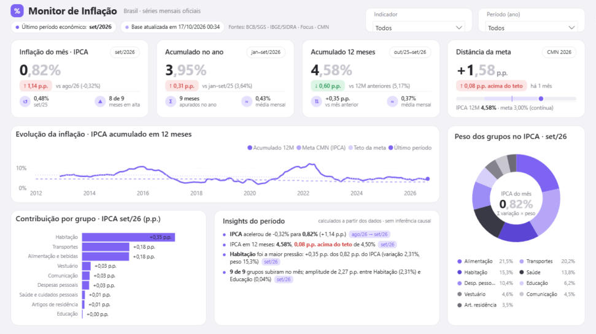
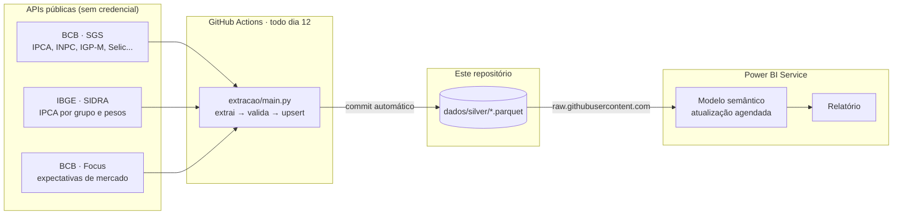

# Monitor de Inflação Brasil

[](https://github.com/SrMateusVinicius/Inflation/actions/workflows/atualizar-dados.yml)

Painel de Power BI que acompanha a inflação brasileira (**IPCA, INPC, IGP-M**, preços livres × monitorados e os 9 grupos do IPCA), compara com a **meta do CMN** e com as **expectativas Focus**, e calcula o **juro real**.
Os dados vêm de APIs públicas oficiais, são tratados em Python e atualizados **todo mês, sozinhos**, pelo GitHub Actions; o Power BI Service lê a base direto deste repositório.



## Destaques

- **Pipeline automatizado e sem custo**: GitHub Actions extrai, valida e versiona os dados todo dia 12; o Power BI Service atualiza a partir do GitHub, **sem gateway e sem servidor**.
- **Arquitetura em camadas** (bronze → silver) com Parquet tipado, gravação atômica e carga idempotente (reprocessar nunca duplica).
- **Qualidade de dados**: validação de faixa por série, checagem de lacunas e duplicidades, pesos dos grupos somando 100% e **IPCA 12 meses calculado conferido com a série oficial (SGS 13522)** — 0 meses divergentes.
- **Modelo semântico em estrela** versionado como código (PBIP/TMDL), 158 medidas DAX em pastas, acumulados sempre compostos `Π(1 + taxa) − 1`.
- **Relatório de 5 páginas** com cards executivos em HTML, seletor de indicador, insights calculados e página de metodologia.

## Arquitetura



| Camada | Conteúdo |
|---|---|
| **Fontes** | BCB/SGS (433 IPCA, 13522 IPCA 12M, 188 INPC, 189 IGP-M, 11428 Livres, 4449 Monitorados, 4189 e 4390 Selic), IBGE/SIDRA (tabelas 1419 e 7060: variação e peso dos 9 grupos), BCB/Olinda (Focus anual do IPCA) e metas do CMN |
| **Bronze** | JSON bruto de cada chamada (gerado na execução, não versionado) |
| **Silver** | 7 arquivos Parquet tipados — `fIndicadores`, `fIPCAGrupos`, `fExpectativas`, `dIndicador`, `dGrupoIPCA`, `dMeta`, `_controle_carga` |
| **Modelo** | Estrela com `dCalendario` mensal (Power Query), 5 relacionamentos 1:* unidirecionais, `dMeta` desconectada |
| **Relatório** | Visão Geral · Composição · Comparativos · Expectativas e Juros · Metodologia |

## Atualização automática

### 1. GitHub Actions (dados)

O workflow [`.github/workflows/atualizar-dados.yml`](.github/workflows/atualizar-dados.yml):

1. roda **todo dia 12 às 08:00 (Brasília)** — o IPCA é divulgado por volta do dia 10 — ou manualmente em *Actions → Run workflow*;
2. reprocessa os **últimos 12 meses** (captura revisões das fontes; o upsert não duplica linhas);
3. valida tudo antes de gravar; **se uma API falhar ou uma validação não passar, nada é gravado** e a base anterior continua valendo;
4. faz commit apenas dos Parquets da camada silver e guarda os logs como artefato por 30 dias.

Não há secrets: as APIs são abertas e o único acesso de escrita é o token temporário do próprio Actions (`permissions: contents: write`).

### 2. Power BI Service (relatório)

As consultas leem os Parquets pela URL pública do GitHub, com a URL base fixa e o caminho no `RelativePath` (forma aceita pela atualização agendada do Service):

```m
Parquet.Document ( Binary.Buffer ( Web.Contents (
    "https://raw.githubusercontent.com",
    [ RelativePath = pRepositorio & "/dados/silver/fIndicadores.parquet" ]
) ) )
```

`pRepositorio` = `SrMateusVinicius/Inflation/main`. No Service: credencial **Anônimo**, privacidade **Público**, atualização agendada após o dia 12. Não é preciso gateway.

## Como executar localmente

```bash
git clone https://github.com/SrMateusVinicius/Inflation.git
cd Inflation
python -m venv .venv
# Windows: .venv\Scripts\activate   |   Linux/macOS: source .venv/bin/activate
pip install -r extracao/requirements.txt          # Python 3.11+

python extracao/main.py --inicio 2012-01 --fim atual   # carga completa
python extracao/main.py --inicio 2025-01 --fim atual   # só o período recente
python extracao/main.py --fontes sgs,focus             # só algumas fontes
```

| Parâmetro | Padrão | Função |
|---|---|---|
| `--inicio aaaa-mm` | `2012-01` | Primeiro mês extraído |
| `--fim aaaa-mm \| atual` | mês corrente | Último mês (meses não publicados são ignorados) |
| `--fontes` | `sgs,sidra,focus` | Reprocessa só as fontes indicadas |
| `--csv` | desligado | Também gera CSV (`;` e `,` decimal) para inspeção |
| `--verbose` | desligado | Log detalhado |

Códigos de saída: `0` ok · `2` falha de validação · `3` falha de API · `1` erro inesperado.
A pasta do projeto é detectada automaticamente (ou pela variável `INFLACAO_RAIZ`).

Para abrir o relatório: Power BI Desktop → abrir `powerbi/MonitorInflacao.pbip` → **Atualizar**.

## Estrutura

```
├── .github/workflows/atualizar-dados.yml   automação mensal
├── extracao/                               pipeline Python
│   ├── config.py           séries, tabelas, metas do CMN, parâmetros HTTP
│   ├── clientes_api.py     clientes SGS / SIDRA / Focus (retry com backoff, paginação)
│   ├── transformacoes.py   tipagem, esquemas e validações
│   └── main.py             orquestração, upsert e gravação atômica
├── dados/silver/           Parquets lidos pelo Power BI (atualizados pelo Actions)
├── powerbi/
│   ├── MonitorInflacao.pbip              projeto Power BI (abrir no Desktop)
│   ├── MonitorInflacao.SemanticModel/    modelo em TMDL
│   ├── MonitorInflacao.Report/           relatório em PBIR
│   └── _gerador/                         scripts que geram medidas e páginas
└── docs/
    ├── medidas_dax.md        catálogo das medidas
    └── modelo_semantico.md   tabelas, colunas e Power Query
```

## Decisões técnicas

| Decisão | Motivo |
|---|---|
| Parquet em vez de CSV | Tipos preservados, sem ambiguidade de vírgula decimal, arquivos pequenos |
| Acumulados compostos | Taxas mensais não se somam: `Π(1 + taxa) − 1` |
| Diferenças em p.p. | Comparação entre taxas em pontos percentuais, não em variação relativa |
| Rosca com **pesos** | Pesos somam 100%; contribuições podem ser negativas e ficam no ranking de barras |
| Variação ≠ contribuição | "Maior alta" usa variação %; "maior pressão" usa variação × peso |
| `dMeta` desconectada | A meta é lida pelo ano do mês de referência, sem filtros bidirecionais |
| Selic 4390 além da 4189 | A 4189 é anualizada; o juro real 12M exige a taxa mensal efetiva |

## Limitações

- A difusão é calculada por **grupo** (9 itens), não pelo índice oficial por subitem.
- As metas do CMN são estáticas em `extracao/config.py` e precisam ser atualizadas quando houver nova resolução.
- Se uma API pública ficar indisponível no dia agendado, a execução falha sem alterar os dados; basta rodar de novo manualmente.

## Fontes

Banco Central do Brasil (SGS e Sistema de Expectativas de Mercado) · IBGE (SIDRA) · Conselho Monetário Nacional.
Dados públicos, usados apenas para fins de estudo e portfólio.
